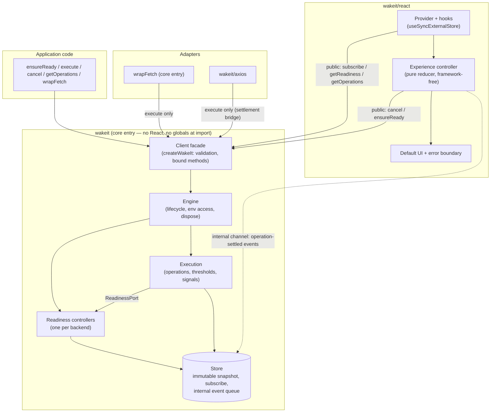
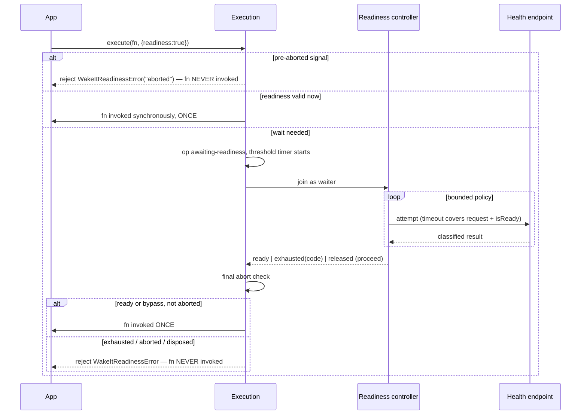

# WakeIt — Architecture (v1.0)

Status: Phase 1 — review revision. Scope source of truth: [docs/specification/](../specification/). Companion docs: [STATE_MACHINES](STATE_MACHINES.md) · [DECISIONS](DECISIONS.md) (records `AD-n`, risks `R-n`, Phase 0 amendment proposals `A-n`, owner decisions `O-n`).

This document contains **no implementation code**. Tables of fields and signatures are contracts, not source.

## 1. Overview

WakeIt is one npm package with a framework-free **core** and thin layers above it. Organizing rule:

> **Public-API-first layering.** `wakeit/react`, the experience controller, `wrapFetch` and the Axios adapter are built on the core's public client interface. The only additional coupling is one narrow, versioned, **non-exported internal channel** (§2.1) used by the React layer; nothing else bypasses the public API.



## 2. Module map

```text
src/
├── index.ts                public core entry: createWakeIt, wrapFetch, errors, public types
├── core/
│   ├── client.ts           facade: validated options, bound (this-free) methods, frozen client
│   ├── engine.ts           composition root; lifecycle (active → disposed); owns env access
│   ├── store.ts            immutable snapshot, subscribe, coalesced notify, freshness timer
│   ├── events.ts           internal channel: symbol-keyed accessor + operation-settled queue
│   ├── config.ts           normalize (backend → backends{default}), groups, validate
│   ├── errors.ts           WakeItReadinessError, WakeItConfigError, brand-based instanceof
│   ├── env.ts              lazy access to timers / fetch / AbortController / online source
│   └── types.ts            public + internal types (public subset re-exported by index.ts)
├── readiness/              controller.ts · run.ts (pure) · probe.ts · policy.ts · validity.ts
├── execution/              executor.ts · operation.ts (pure) · signals.ts · thresholds.ts
├── fetch/                  wrap-fetch.ts   (P1; bundled in the core entry, tree-shakeable)
├── experience/             framework-free; bundled into wakeit/react
│   └── reducer.ts · controller.ts · copy.ts (evidence → message selection)
├── react/                  entry wakeit/react ("use client")
│   └── provider.tsx · hooks.ts · host.tsx · boundary.tsx · default-ui/ (overlay, banner P1, styles)
├── axios/                  entry wakeit/axios (P1) — type-only axios imports
└── shared/                 deferred(), internal-channel key constant, small pure helpers
```

**Dependency direction** (arrow = "may import"):

```text
shared ← core / readiness / execution ← fetch
shared ← experience ← react
shared ← axios
react, experience, axios, fetch reach the core only through the client interfaces in §2.1 (type imports allowed).
readiness and execution never import each other: the engine gives execution a ReadinessPort.
```

Enforced by ESLint (`no-restricted-imports`, `import/no-cycle`); CI fails on violation.

### 2.1 Interface tiers

Four tiers; only the first is consumer-facing API and covered by semver.

| Tier | Audience | Stability | Contents | Exported? |
|---|---|---|---|---|
| **1. Package public API** | Application developers | Semver | Core entry: `createWakeIt`, the `WakeIt` client (`ensureReady`, `execute`, `getReadiness`, `getOperations`, `cancel`, `subscribe`, `dispose`, `wrapFetch`), `WakeItReadinessError`, `WakeItConfigError`, public types (explicit allow-list). React entry: `WakeItProvider`, `useWakeIt`, `useReadiness`, `useWakeItOperations`, `ExperienceProps`/`ExperienceActions`/`OperationInfo` types. Axios entry: `attachWakeIt`. | Yes |
| **2. Internal core interfaces** | Core subsystems and tests | Free to change between any releases | `ReadinessPort` (execution → readiness: join as waiter, leave, release callbacks); `StoreWriter` (commit) vs `StoreReader`; `EngineDeps` (injectable `fetch`, online source; used by tests via an internal factory); transition/effect types of the three pure machines; **the internal channel** (below). | **No** — not exported from any entry |
| **3. Adapter interface** | `wrapFetch`, `wakeit/axios` | Public contract is `execute` | An adapter receives `Pick<WakeIt, "execute">` and may call only that. No access to the store, readiness, or channel. | Adapter functions are public; the narrow type is internal |
| **4. React integration interfaces** | `wakeit/react` | Public: props/hooks above. Internal: `ExperienceController` (state + actions), slice-hook helper | The controller consumes the public client (`subscribe`, `getOperations`, `getReadiness`, `cancel`, `ensureReady`) **plus the internal channel** for `operation-settled` events. Custom experiences see only `ExperienceProps`. | Internal parts: **No** |

**The internal channel** is the single non-public coupling. It is a small object attached to the (frozen) client under a **registry symbol** (`Symbol.for(...)`), exposing `version` and `onSettled(listener)`; it is declared in an internal type file and re-exported by **no** entry, so it appears in no public `.d.ts`. Properties:

- *Why a symbol on the instance, not a module registry:* ESM/CJS or bundler duplication would give each entry its own module state; the client instance travels with the application, so the lookup always works. Both entries ship in one package version, so channel and consumer always match.
- *Version tag + graceful degradation:* if the channel is missing or has an unknown version (client from a foreign copy), the experience controller drops only the `failed` phase and warns in development.
- *Unsupported for consumers:* documented as internal; may change in any release. **Promotion rule:** it becomes public only if a concrete developer use case beyond the default UI appears (then via an approved, designed API — not by documenting the symbol).
- *Payload:* `{id, kind, group, backend?, outcome, origin, code?, slowness}`. Never error objects, responses, URLs, headers.

Why not alternatives (full detail in AD-1/AD-2): a public event emitter has no developer use case today; a readiness-snapshot failure counter pollutes a public type and is ambiguous about *which* operation failed; retaining settled operations contradicts API §4.1.8 and leaks memory; a module-level registry breaks under duplication.

## 3. Subsystem responsibilities

| Subsystem | Owns | Does not own |
|---|---|---|
| **Engine + store** | Lifecycle, config, env access, the single immutable state tree, subscriptions, notification, the internal event queue and its flush order, the observed-expiry timer. | Probing details, operation bookkeeping, any UI concept. |
| **Readiness** | Per-backend probe run, policy, status, validity, waiters, probe timers and online/offline listeners. | Operations, UI, outcome events. |
| **Execution** | Operation lifecycle, threshold timers, per-op `AbortController`, `fn` invocation, settlement, outcome events. | Readiness internals (talks to `ReadinessPort`), UI. |
| **Experience controller** | Visible operations, dismissal, failure notices, minimum-visible time, phase, copy selection. Outside the core: these are presentation concerns. | Mutating operations (only public `cancel(id)` / `ensureReady()`). |
| **React layer** | Subscriptions, rendering, focus/a11y, error boundary. | Business logic. |
| **Adapters** | Turning a transport into `execute` calls. | Retries, header/credential changes, response handling, anything beyond `execute`. |

## 4. Public API architecture

The v1 surface is API_DESIGN §2 plus the owner-approved additions (O-1, O-2). Phase 0 documents still need the amendments listed in DECISIONS §4 (A-1…A-8); this architecture is written against the amended surface.

| Addition (approved) | Use case that justifies it as public API |
|---|---|
| `getOperations()` | `useWakeItOperations()` and any custom or non-React UI that renders tracked operations. |
| `cancel(operationId)` | Custom experiences/UI implementing a Cancel action; `ExperienceProps.actions.cancel` is public. |
| `groups` config | Per-group thresholds (FR-M4, AC-N2). |

Rejected / not added: `ReadinessSnapshot.failedWaits` (O-1 direction followed — readiness failure is represented as a lifecycle **event on the operation**, internal, §2.1); any public event emitter; exposing `ReadinessPort`, the store, or the channel.

### 4.1 Facade rules

- Methods are **closures, not prototype methods** (`const { execute } = useWakeIt()` works; hook results are referentially stable).
- Invalid options never throw synchronously from `execute`/`ensureReady`: they **reject** with `WakeItConfigError` before any side effect (a Promise-returning API never mixes sync throws and rejections). `createWakeIt` validates and throws synchronously.
- The client object is frozen; internals are reachable only through its methods (plus the internal channel).
- Config is immutable after creation (no runtime reconfiguration).

### 4.2 Snapshot and method contracts

| Type | Fields / semantics |
|---|---|
| `ReadinessSnapshot` | `backend`, `status` (`unknown\|checking\|ready\|not-ready\|unreachable\|offline`), `reason?` (`rejected\|invalid-response\|timeout\|network-error\|offline\|expired`), `attempts`, `checkedAt?`, `validUntil?`. **Never `ready` at/after `validUntil`.** |
| `OperationSnapshot` | `id`, `kind` (`request\|readiness`), `group`, `backend?`, `stage` (`awaiting-readiness\|running`), `slowness` (`quiet\|slow`), `startedAt`, `cancellable`, `cancelRequested`. Consumers compute `elapsedMs`. |
| `getOperations()` | Frozen, identity-stable list of **all live tracked operations** (quiet and slow; settled ones are gone). Empty list is a shared constant. The experience's `operations` prop is the *visible* subset. |
| `cancel(operationId)` | Requests cancellation. Idempotent; **silent no-op** for unknown, settled, non-`cancellable`, or `ensureReady` operations. For a `cancellable` op: sets `cancelRequested`, aborts the engine signal; in `awaiting-readiness` this is real cancellation. The name follows the owner decision; its documentation must say it *requests* cancellation (never "cancels the operation"). |
| Config `groups` | `{ [group]: { thresholdMs? } }`; `thresholdMs` finite ≥ 0. Precedence: call > group > client `thresholdMs` > provisional default 1500 ms; resolved once at operation creation. Unknown group labels simply fall through. |

Settled operations never appear in snapshots; error objects and responses are never stored in state.

### 4.3 Type-system direction

- `execute<T>` infers `T` from `fn: (ctx: { signal }) => Promise<T>`; runtime additionally tolerates thenables/plain values (STATE_MACHINES §3.1) without widening the public type.
- Config is a union with `backend` / `backends` mutually exclusive (`never`-typed counterpart), validated at runtime for JS callers.
- Internal types are not exported; `index.ts` has an explicit allow-list.
- `ExperienceProps` lives in `wakeit/react` types and is built from public snapshot types.

## 5. Data flow

### 5.1 `execute(fn)` — monitoring only
1. Facade validates options (failure ⇒ rejected `WakeItConfigError`, nothing created); engine checks `AbortController` availability at this point (not at import).
2. Executor creates the operation (`running`, `quiet`), resolves the threshold, starts the threshold timer, creates the op controller, links the caller's `signal`.
3. **`fn({ signal })` is invoked synchronously inside the call** (exact contract: STATE_MACHINES §3.1).
4. On the threshold, `slowness` flips; notification; the experience reacts.
5. On settlement: cleanup → commit removal → queue `operation-settled` → settle the caller's promise with `fn`'s exact outcome.

### 5.2 `execute(fn, { readiness })` — combined



### 5.3 UI path
`client.subscribe` (microtask-coalesced) → experience controller processes queued `operation-settled` events, then reads `getOperations()`/`getReadiness()` → pure reducer → React re-renders via `useSyncExternalStore`. UI → engine only through public `cancel(id)` and `ensureReady()`; **dismissal never reaches the engine**.

## 6. Readiness architecture (detail: STATE_MACHINES §2)

- **One controller per backend id per client**, created lazily; P0 uses `default`. The Map keyed by backend id exists from day one (D9).
- **Shared demand-driven run:** at most one probe loop per controller, started by the first waiter and stopped when the last waiter leaves, the policy is exhausted, or the client is disposed. Duplicate probes are impossible by construction.
- **Probe attempt:** lazily resolved `fetch`; `cache: "no-store"`; developer-supplied method/headers; default credentials mode; the attempt timer covers request **and** `isReady`; stale results are discarded by generation token; the response body is cancelled best-effort after validation.
- **Classification and evidence:** reasons `rejected`, `invalid-response`, `network-error`, `timeout`, `offline`. A probe **timeout** is *not* proof the backend is unreachable — it is "no usable response within the limit". Status `unreachable` carries reason `timeout` or `network-error`; copy and developer messages key on **reason** (STATE_MACHINES §2.3); error codes keep `timeout` and `unreachable` distinct.
- **Offline:** listeners exist only during a run. A failed attempt while the online source reports offline is `offline`, consumes no attempt, and waits for `online` (bounded by the run deadline). WakeIt never pre-blocks on `onLine === false`.
- **Freshness (review A):** validity is stored as `validUntil`. (1) `getReadiness()` **normalizes at read time**, so no snapshot reports `ready` after expiry even if timers are throttled; (2) an **observed-expiry timer** (one per ready backend, only while ≥ 1 subscriber, `unref`'d in Node) commits the normalized state and notifies so hooks update. With no run, operation or subscriber there are no engine timers or listeners.

## 7. Execution architecture (detail: STATE_MACHINES §3)

- Operation identity: per-client monotonic id (`op-<n>`); no randomness/crypto. Group = developer label only (no queueing, dedup, or serialization of `fn`s). Backend = config key.
- **Invocation contract** (STATE_MACHINES §3.1): synchronous invocation when no wait is needed; exactly once via a single-use stage transition; synchronous throws become rejections with the thrown value itself; native promises, thenables and plain values are handled by standard promise resolution; the returned promise is derived (value/reason identity guaranteed, microtask timing not); cleanup after immediate failure uses the same settle path; cleanup/subscriber errors are contained.
- **Signals:** engine-owned `AbortController` per operation; caller's signal linked **manually** (listener + cleanup), never aborted by WakeIt; pre-aborted behavior: plain ⇒ `fn` invoked once with an aborted signal; combined ⇒ reject `aborted`, `fn` never invoked (O-4).
- **Thresholds:** `thresholds.ts` resolves call > group > client > default (O-2).

## 8. State store, React integration and SSR

- **State vs derived:** one immutable root per client written only by engine commits; slow/visible/phase/copy and `elapsedMs` are derived.
- **Notification:** commits mark the store dirty; one flush per microtask runs internal events then subscribers; getters are read-your-writes; subscriber exceptions are contained; re-entrant commits are queued.
- **Slice stability:** `getReadiness(b)` and `getOperations()` keep identity until their slice changes, so `useSyncExternalStore` bails out for unrelated changes (AC-X3). `getReadiness(b)` identity also changes at expiry (§6).
- **React specifics:** hooks use `useSyncExternalStore(client.subscribe, sliceGetter, serverSnapshotGetter)`. The provider never disposes the client; creation of the experience controller has no side effects until subscribed (Strict Mode safe); nested providers for one client render only the outermost host; `wakeit/react` has a `"use client"` banner, the core does not.
- **SSR contract (O-3)** — also asserted by tests (AC-S1/S2):
  1. **Import:** no globals read, no side effects (`sideEffects: false`).
  2. **`createWakeIt`:** validates and builds objects only — no network, timers, listeners, or global access.
  3. **React render** (provider, hooks, experience host): pure — no probes, timers, listeners, DOM access or style injection. The default overlay renders nothing unless an operation is visible, which can only happen on the client.
  4. **Server snapshot:** `getServerSnapshot` returns a **constant empty snapshot** (no operations; readiness `unknown`), **not** the live client state. A module-level client shared across server requests therefore can never leak another request's in-flight operations into rendered HTML, and server HTML equals the client's first hydration render. If the live client already differs at hydration, React re-renders after hydration with the live snapshot.
  5. **Explicit calls** (`ensureReady`, `execute`) do real work in any environment, including Node; calling them *during render* is a developer error WakeIt cannot detect — documented ("call from handlers, effects, loaders").
  6. WakeIt stores no user-specific data in the client, so sharing one client across server requests is safe in terms of data exposure; the only shared state is backend readiness, which is global by nature.
- **Default UI:** portal rendered only when visible; focus trap/restore, live-region status, reduced-motion CSS. Styling is an injected scoped `<style>` (`wakeit-` classes, `--wakeit-*` variables, `data-theme`, optional `nonce`); `theme="auto"` is pure CSS. The error boundary wraps only the experience subtree.

## 9. Adapter boundaries

| Adapter | Mechanism | Guarantees / limits |
|---|---|---|
| `wrapFetch` (P1, core entry) | Receives `Pick<WakeIt,"execute">` and calls `execute(({signal}) => fetchImpl(input, init'))`. **Not cancellable:** arguments pass to `fetchImpl` **unchanged** (same objects). **Cancellable, non-`Request` input:** `init'` differs only by `signal` (engine signal; caller's `init.signal` is linked as the execute `signal`). `Request` inputs are never rebuilt: tracked, not cancellable via WakeIt. | Tracking ends at response headers; `Response` returned as-is; no retries; HTTP errors resolve normally and are never readiness evidence. |
| `wakeit/axios` (P1) | Interceptors + **settlement bridge** over `execute` only: the request interceptor calls `execute(() => bridgePromise, …)`; response/error interceptors settle the bridge; the bridge promise is internal and silenced. With `readiness`, the async request interceptor awaits the moment `execute` invokes the bridge fn and otherwise rejects with the readiness error (request not sent). | Observation-only; not cancellable through WakeIt; no config/response/error mutation beyond tracking metadata; cut if unverifiable (highest-risk P1, R-2). Type-only Axios import. |

## 10. Packaging and build

| Entry | Exports | Notes |
|---|---|---|
| `wakeit` | `createWakeIt`, `wrapFetch`, errors, public types | `sideEffects: false`; no `react` import. |
| `wakeit/react` | Provider, hooks, `ExperienceProps` etc. | `react` peer; experience controller + default UI bundled; no runtime import of core modules. |
| `wakeit/axios` | `attachWakeIt` | `axios` optional peer, type-only. |

`wakeit/fetch` is **not** created (AD-11).

| Concern | Choice | Reasoning |
|---|---|---|
| Language | TypeScript strict (`exactOptionalPropertyTypes`, `isolatedModules`) | DX goals. |
| Package manager | pnpm | Strict resolution, fast CI, peer-matrix testing. |
| Bundler | tsup (verify upkeep) / tsdown alternative | Multi-entry, banner for `"use client"`, ESM + CJS + `.d.ts`. Final at scaffolding (AD-13). |
| Tests | Vitest + fake timers; React Testing Library; jsdom/happy-dom | One toolchain. |
| HTTP integration | Real local `http` server | Verifies actual headers/body/abort behavior (AC-F1). |
| Browser | Playwright + axe | Focus/a11y/navigation/CORS. |
| Lint/format | ESLint (typescript-eslint, react-hooks, import boundaries), Prettier | Boundaries enforced mechanically. |
| Package correctness | `publint`, `are-the-types-wrong` | Catches `exports`/dual-format errors. |
| Size | `size-limit` | Enforces proposed budgets once validated. |
| Releases / CI | Changesets (optional); GitHub Actions: Node LTS × React 18/19 | Semver discipline; support matrix. |

Dual-package hazard: `wakeit/react` and `wakeit/axios` import no runtime core code; brand-based `instanceof` for errors (AD-8); the internal channel lives on the instance (§2.1).

## 11. Testing architecture

Determinism: Vitest fake timers; **two injected dependencies only** (`fetch`, online source) through an internal, non-public factory; deferred promises; pure transition functions.

| Layer | What | Techniques |
|---|---|---|
| Pure units | Policy math, classification, transition functions, threshold resolution (call > group > client > default), copy selection, config validation | Table-driven; every transition-table row is a case. |
| Model/interleaving | Operation machine, readiness run, cancellation × invocation | Exhaustive short-sequence enumeration with invariants (STATE_MACHINES §8, TR-C3). |
| Invocation contract | Sync/async invocation, throws, thenables, identity, re-entrancy, cleanup | STATE_MACHINES §9 TR-I1…I7. |
| Freshness | Expiry, timer arming, throttling | TR-F1…F4. |
| Core integration | Engine + injected fetch | E-1…E-15, AC-R/M/B/K/N. |
| React | Provider/hooks | Strict Mode, unmount cleanup, render counts, `renderToString` + hydration with a pre-busy shared client (server snapshot constant) (AC-S1, AC-X3). |
| HTTP integration | Real server: 503→200, 204, JSON variants, hang, closed port, redirects, streaming | AC-R2/R4, AC-F1. |
| Browser | Overlay, focus trap, keyboard, reduced motion, navigation, 50 concurrent ops, CORS-failure appearance | Playwright + axe; Next.js App Router sample (AC-A\*, AC-N1, AC-S2). |
| Package | exports resolution (Node ESM/CJS, Vite, Next), `npm pack`, zero `dependencies` | publint, attw, install-and-import smoke (AC-P\*). |

Invariants asserted by every scenario test: STATE_MACHINES §8 (call counts, timers/listeners balance, identity, no unhandled rejections, freshness truthfulness).

## 12. Reliability, security and performance

| Topic | Position |
|---|---|
| Guarantees | `fn` called ≤ 1 per `execute`; outcome identity preserved; no WakeIt error after `fn` starts; bounded probe loops; cleanup of own timers/listeners; **no readiness snapshot reports `ready` after expiry**; no implicit work at import/create/render/mount; no logging of bodies/headers/queries. |
| Not guaranteed | That `fn` honors `signal`; that a network/CORS failure means "down"; that a probe timeout means "unreachable"; `navigator.onLine` accuracy; that hanging `fn`s settle; third-party patched `fetch` behavior. |
| Sensitive data | Probe headers are developer config, sent only to the health URL, never logged or placed in errors/snapshots/events. Errors carry `code`, `backend`, `attempts`, `elapsedMs`, optional `cause`. Debug logging (P1) redacts query/fragment/userinfo and header values. |
| CORS / CSP | Cross-origin health URLs need CORS (custom headers trigger preflight) and CSP `connect-src`; `no-cors` is not used (opaque responses cannot be validated). Injected styles need `style-src` or a nonce. |
| Rejections | Only the caller-facing promise can reject; internal promises are always handled; subscriber/observer/`isReady` exceptions contained. |
| Idle profile | No run, no operation, no subscriber ⇒ zero timers/listeners/network. With subscribers: at most one `unref`'d expiry timer per ready backend (needs requirement clarification A-6). |
| Scale | O(1) per-operation bookkeeping; slice arrays rebuilt lazily per change; microtask-coalesced notifications. **Numbers remain proposed targets** pending Phase 2 measurement. |

## 13. Conformance and final review

P0 ownership: FR-R1–R7 → `readiness/`; FR-M1–M9 → `execution/` + `core/store`; FR-X1–X7 → `experience/` + `react/`; FR-D1–D3 → `core/config`, `core/errors`, types, SSR rules; NFRs → §10–12; ACs → §11. Open amendment items are in DECISIONS §4.

| # | Question | Answer |
|---|---|---|
| 1 | Core operates without React? | Yes. |
| 2 | Independent clients? | Yes: all state per client; the internal channel is per instance. |
| 3 | Concurrent requests safe? | Yes: independent operations, timers, controllers. |
| 4 | Shared readiness, no duplicate loops? | Yes: one run per backend; waiters join. |
| 5 | Operations finish without UI mounted? | Yes: UI is only a subscriber/observer. |
| 6 | UI fully replaceable? | Yes (`experience` prop, or hooks/core only). |
| 7 | Cancellation without changing promise semantics? | Yes (STATE_MACHINES §3, §5.1, §6). |
| 8 | Readiness vs operation errors distinguishable? | Yes: WakeIt errors only before `fn` starts; config errors reject before any state. |
| 9 | All timers/listeners cleaned? | Yes per ownership table (STATE_MACHINES §7); residual: signal listeners of still-running `fn`s until they settle. |
| 10 | SSR safe? | Yes: SSR contract §8 (constant server snapshot, no work in render). |
| 11 | Adapters isolated? | Yes: `Pick<WakeIt,"execute">` only. |
| 12 | Deterministic tests? | Yes. |
| 13 | Unnecessarily complicated? | Watch-items: pure-transition style vs size budget (AD-17); Axios bridge (R-2); the internal channel (kept to one event type, with a promotion rule). |
| 14 | Matches every P0? | Yes, subject to amendments A-1…A-8. |
