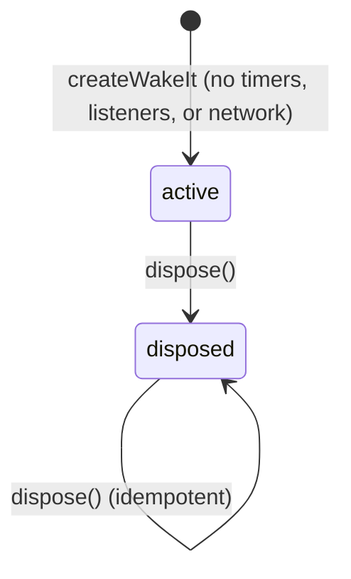
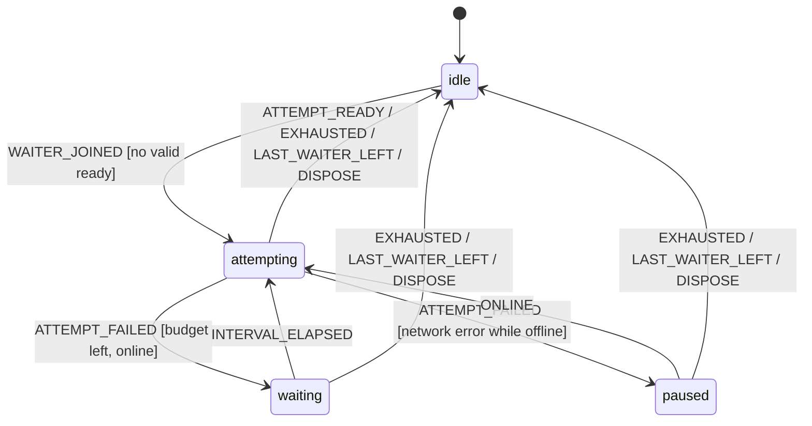
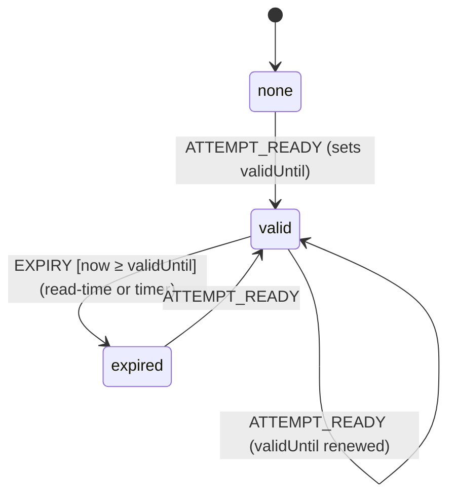
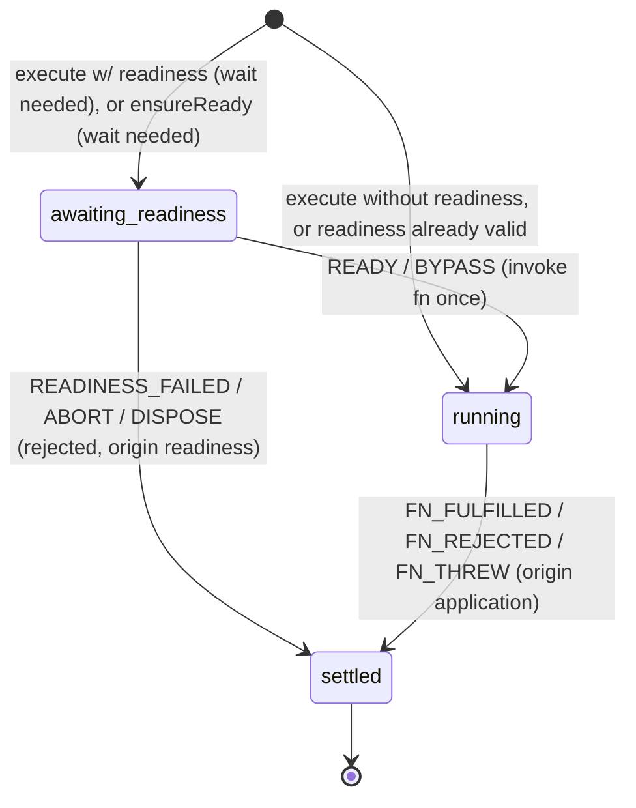
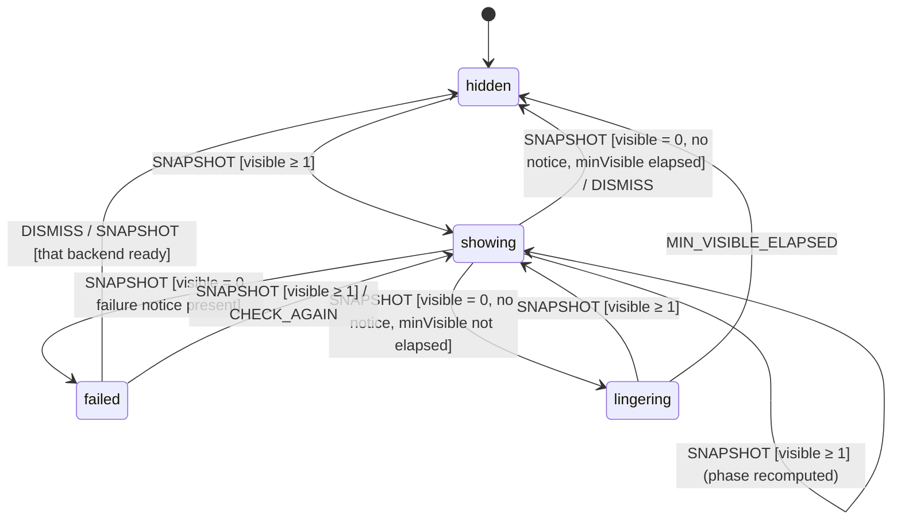

# WakeIt — State Machines (v1.0)

Status: Phase 1 — review revision. Terminology follows the specification (`ensureReady`, `execute`, *dismiss ≠ cancellation request ≠ actual cancellation*). Module placement and interface tiers: [ARCHITECTURE §2](ARCHITECTURE.md). Rationale: [DECISIONS](DECISIONS.md).

## 0. Conventions

- **No ambiguous boolean combinations.** Each machine has an enumerated state; independent facts coexist as **parallel regions** with tiny enumerated domains (operation: stage / slowness / cancel; readiness: run / validity).
- **Transitions are pure** (`(state, event) → state + effects`) for the readiness run, the operation, and the experience. A small interpreter executes effects. Events invalid in a state are **ignored** (never thrown) and counted in dev diagnostics.
- **Staleness rule:** every timer, attempt and listener callback captures a token (run generation / operation identity / validity stamp). On firing it must still match the live token, otherwise it is a no-op.
- **Settlement order** (operations): record outcome → release resources → commit state (operation removed) → queue the internal `operation-settled` event → settle the caller's promise. Code after `await execute()` therefore observes state that already excludes the operation.
- **Notification flush** (once per microtask, coalesced): internal events first (experience controller), then snapshot subscribers. Getters are read-your-writes.
- Effects never throw into a machine; each is individually guarded. Subscriber and observer exceptions are contained.

## 1. Engine lifecycle

On entering `disposed` (synchronously, in order):
1. Readiness controllers: stop runs (clear timers incl. the freshness timer, remove `online`/`offline` listeners, abort the in-flight attempt, bump generation); reject every waiter with `WakeItReadinessError("aborted")`.
2. Operations in `awaiting-readiness` → `settled(rejected, readiness, aborted)`; `fn` never invoked.
3. Operations in `running`: threshold timers cleared; **`fn` untouched**; the caller's `signal` link stays until settlement (it is the caller's own request); outcome passes through as usual.
4. Store: subscribers and internal observers dropped; getters keep returning the last frozen snapshot.

After disposal: `subscribe` returns a no-op unsubscribe; `cancel(id)` is a no-op; plain `execute(fn)` invokes `fn` once, untracked (pass-through — business code must not break because monitoring was disposed); `execute` with `readiness` and `ensureReady` reject `aborted`. A provider never disposes a client it did not create.

## 2. Readiness (one controller per backend id)

Two regions: **Run** (probe loop, internal) and **Validity** (freshness). Public status is a projection of both.

### 2.1 Run region

| State | Owns | Timers / listeners |
|---|---|---|
| `idle` | nothing | none |
| `attempting` | one attempt (request + `isReady`), generation token | attempt-timeout timer, run-deadline timer, `online`/`offline` listeners |
| `waiting` | next-attempt delay | interval timer, deadline timer, listeners |
| `paused` (offline) | wait for `online` | deadline timer, listeners (no interval timer; no attempt consumed) |

| Event | From | Guard | To | Effects |
|---|---|---|---|---|
| `WAITER_JOINED` | `idle` | validity is `valid` (now < `validUntil`) | `idle` | resolve waiter immediately; no probe, no timers, no operation record. |
| `WAITER_JOINED` | `idle` | otherwise | `attempting` | status → `checking`, attempts 0; start deadline timer; attach listeners; start attempt. |
| `WAITER_JOINED` | running states | — | same | add waiter; it **shares the run's budget/deadline** (AD-4). |
| `ATTEMPT_READY` | `attempting` | token match | `idle` | Validity → `valid`; status `ready`; release all waiters; cleanup. |
| `ATTEMPT_FAILED` | `attempting` | token match | `waiting` | status per §2.2; attempts++; schedule interval (policy). |
| `ATTEMPT_FAILED` | `attempting` | network error **and** online source reports offline | `paused` | status `offline`; attempt not counted. |
| `EXHAUSTED` (attempts or deadline) | any running | — | `idle` | reject non-bypassing waiters with `WakeItReadinessError(code of last reason)`; **release** bypassing waiters (`onFailure:"proceed"`, bypassable code) so their operations invoke `fn`; cleanup. |
| `INTERVAL_ELAPSED` | `waiting` | token match | `attempting` | start attempt. |
| `ONLINE` | `paused` | — | `attempting` | start attempt immediately. |
| `WAITER_LEFT` (abort) | running | other waiters remain | same | reject that waiter `aborted`. |
| `WAITER_LEFT` (abort) | running | none remain | `idle` | abort in-flight attempt, bump generation, cleanup; last status evidence retained. |
| `DISPOSE` | any | — | `idle` (engine terminal) | cleanup; reject all waiters `aborted`. |

Ignored: `ATTEMPT_*` with a stale token, `INTERVAL_ELAPSED` outside `waiting`, `ONLINE` outside `paused`. The readiness controller does **not** emit operation outcomes; it only resolves/rejects/releases waiters. Outcome events come from the operation layer (§3).

**Implementation notes (Phase 4).**
- `attempts` counts attempts that finished `ready` or failed for a reason other than `offline`; `maxAttempts` is compared to it. A run that ends `ready` reports the successful attempt in `attempts`.
- The first attempt starts immediately; every retry waits `retryDelay(failedAttempts)` (AD-19). `ONLINE` resumes with an immediate attempt.
- `DEADLINE` also covers an attempt still in flight. With no evidence from this run yet, the abandoned attempt becomes the evidence: status `unreachable`, reason `timeout`, code `timeout`.
- Only the `online` event is listened to (`offline` is detected from the failed attempt), and only while a run exists.
- When the last waiter leaves, a status still at `checking` is restored to its pre-run snapshot; failure evidence is kept. Disposal does the same without notifying.
- A caller's abort signal removes only its waiter; the shared run is untouched while others wait. `ensureReady` with a pre-aborted signal rejects `aborted` even if readiness is fresh.
- Until the execution phase, `ensureReady` is not tracked as an operation (no threshold or experience).

### 2.2 Validity region (freshness)

**Public guarantee: no snapshot returned by `getReadiness()` reports `ready` at or after `validUntil`.** Two cooperating mechanisms:

1. **Read-time normalization (truth).** `getReadiness(b)` derives from stored state and the current time: if stored `status` is `ready` and `now ≥ validUntil`, it returns the *expired* snapshot (`status: "unknown"`, `reason: "expired"`, `checkedAt` kept, `validUntil` absent). The derived object is cached per (store version, expired) so repeated reads are identity-stable. Needs no timer; correct even if timers are throttled (background tabs).
2. **Observed-expiry timer (notification).** A single one-shot timer per `ready` backend is armed **only while the store has ≥ 1 public subscriber**: at commit of `ready` (if observed) or at first subscribe (if ready-valid). On fire it re-checks `now ≥ validUntil` (re-arms for the remainder if early), commits the normalized state and notifies, so hooks re-render. It is cleared when status leaves `ready`, at last unsubscribe, and at dispose. The store reports public-subscriber count changes to the engine, which re-syncs the timer (arm on 0→1 while fresh, clear on →0); renewing readiness re-arms it for the new `validUntil`. In Node-like runtimes it is `unref`'d so it never keeps a process alive (probe timers are **not** unref'd).

Resulting idle profile: with no run, no tracked operation and no subscriber, the engine owns **zero timers/listeners**. With subscribers, at most one expiry timer per ready backend and no network activity.

### 2.3 Status projection and evidence

| Status | Set when | `reason` |
|---|---|---|
| `unknown` | initial; or validity `expired` | — / `expired` |
| `checking` | a run starts, until its first attempt resolves | — |
| `ready` | attempt passed `isReady` and validity is `valid` | — |
| `not-ready` | response received but `isReady` false / non-2xx under default validator; or validator threw / body unusable | `rejected` \| `invalid-response` |
| `unreachable` | **no usable response was obtained** | `network-error` \| `timeout` |
| `offline` | network failure while the online source reports offline | `offline` |

Between attempts of one run the status keeps the last failure (no flicker back to `checking`); `attempts` increments. A new run starts at `checking`, so stale failures never count as current evidence.

**What each reason does and does not prove** (copy and developer messages are keyed on `reason`, never on `status` alone — O-5):

| Reason | Proves | Does **not** prove | Error code |
|---|---|---|---|
| `rejected` | Backend answered; it is up but not ready by the developer's criteria | Anything about *why* | `not-ready` |
| `invalid-response` | Backend answered; the validator couldn't interpret it (likely misconfiguration) | Readiness either way | `invalid-response` |
| `network-error` | A connection-level failure occurred (refused, DNS, TLS, blocked cross-origin) | That the backend is down — CORS/CSP/extension failures look identical | `unreachable` |
| `timeout` | No complete response **and validation** within the attempt's time limit | That the backend is unreachable or down: it may be slow to start, the network slow, or the validator hung | `timeout` |
| `offline` | Browser reports no connectivity | Anything about the backend | `offline` |

`unreachable` (status) therefore means "no usable response obtained", a weaker claim than its name. Permitted copy for `timeout` is "hasn't responded yet"; "can't reach" is reserved for `network-error` (see amendment A-5). A `timeout` is classified from the attempt timer, which covers request **and** `isReady`; the late result of a timed-out attempt is discarded.

Reason → error code mapping is in the last column. Bypassable by `proceed`: all codes except `aborted`; config errors are not bypassable. Probe retry happens only inside a run; operation retry never exists.

## 3. Operation lifecycle (one per tracked `execute` / `ensureReady` call)

**Pre-creation guard.** Option/`fn` validation and the environment check happen first. A failure here **creates no operation**, invokes nothing, and is delivered as a **rejected promise** with `WakeItConfigError` (never a synchronous throw from `execute`/`ensureReady`; `createWakeIt` itself throws synchronously). A readiness request when **no backend is configured** (`ensureReady`, or `execute` with `readiness`) is the same kind of failure (O-7): rejected `WakeItConfigError`, `fn` not invoked, nothing created. `ensureReady` with valid readiness resolves without creating an operation.

Regions: **Stage**, **Slowness**, **Cancel**.

`ensureReady` operations (`kind: readiness`) have no `running` stage and are never `cancellable` (they have no such option; the caller aborts via `signal`).

| Region | Domain | Transition |
|---|---|---|
| Stage | `awaiting-readiness` → `running` → `settled{fulfilled \| rejected, origin, code?}` | below |
| Slowness | `quiet` → `slow` | `THRESHOLD_ELAPSED` [stage ≠ settled, token match]. Monotonic; frozen at settle. Clock starts at the call (includes the readiness wait). Threshold resolved once at creation: call > group > client > 1500 ms. |
| Cancel | `none` → `requested` | `CANCEL_REQUESTED` (public `cancel(id)` on a `cancellable` op, or the caller's signal aborting). Monotonic. Never produces a `cancelled` state. |

| Event | Stage | Effect |
|---|---|---|
| `READY` / `BYPASS` | `awaiting-readiness` | **Final abort check** (read `callerSignal.aborted` directly; if aborted → treat as `ABORT`, `fn` not invoked). Else stage → `running` (set *before* invoking), then invoke `fn` (§3.1). `BYPASS` only if `onFailure:"proceed"` and the code is bypassable. |
| `READINESS_FAILED` | `awaiting-readiness` | settle rejected with `WakeItReadinessError`, `fn` never invoked. |
| `ABORT` (caller signal) | `awaiting-readiness` | leave waiter list; settle rejected `aborted`; `fn` never invoked. **Always wins** over a simultaneous `READY`. |
| `ABORT` (caller signal) | `running` | abort the op's controller with the caller's reason; Cancel → `requested`; **no stage change**. |
| `CANCEL_REQUESTED` (public `cancel(id)`) | `awaiting-readiness` | only if `cancellable` (approved Phase 0 contract; **no Cancel for non-cancellable operations in any stage**); then as readiness `ABORT`. |
| `CANCEL_REQUESTED` (public `cancel(id)`) | `running` | only if `cancellable`: abort controller (default `AbortError` reason); Cancel → `requested`. Otherwise ignored. |
| `FN_FULFILLED` / `FN_REJECTED` / `FN_THREW` | `running` | settle with `fn`'s exact value / the same reason object. |
| any event | `settled` | ignored (absorbing: late timers, double aborts, repeated `cancel`). |

`cancel(id)` for an unknown, settled, or non-cancellable id is a silent no-op.

Settle effects (fixed order): record outcome → clear threshold timer → remove caller-signal listener / leave waiter list → commit removal → queue `operation-settled` {id, kind, group, backend?, outcome, origin, code?, slowness-at-settle} (no error objects) → settle caller promise.

### 3.1 Invocation contract (exact behavior of `execute`)

| # | Case | Behavior |
|---|---|---|
| 1 | **When `fn` is invoked** | **Synchronously, inside the `execute` call,** whenever no readiness wait is needed (no `readiness` option, or readiness currently valid). Otherwise after the wait, from the waiter-release callback. Developers must not rely on synchronous invocation in the waiting case. |
| 2 | **Exactly once** | Stage `running` is entered through a single-use transition *before* the call. No other path invokes `fn`; `settled` is absorbing; there are no retries or replays. |
| 3 | **Argument** | One object `{ signal }`. `signal` is the engine's derived signal (never the caller's object). |
| 4 | **Synchronous throw** (any thrown value, including non-`Error`, `undefined`, `null`) | Caught; operation settles `rejected(origin application)` with the **thrown value itself**, inside the same synchronous frame, before `execute` returns. The returned promise rejects with that same value. |
| 5 | **Returns a native promise** | One `then(onFulfilled, onRejected)` attached to it. Fulfillment value is delivered `===`; rejection reason is rethrown `===`. |
| 6 | **Returns a thenable** (non-native) | Supported at runtime via standard promise resolution (`then` is read once and called once; a `then` that throws, or a throwing getter, yields rejection with that exception; multiple resolve/reject calls follow the standard first-wins rule). Public TypeScript type remains `Promise<T>`. |
| 7 | **Returns a plain value** | Treated as fulfilled with that value (standard resolution). Type remains `Promise<T>`; tolerance exists for JS callers. |
| 8 | **Returned promise identity** | A derived promise (not `fn`'s own object; subclass/species rules apply). Value/reason identity is guaranteed; the exact microtask timing relative to `fn`'s promise is **not**. |
| 9 | **Unhandled rejections** | `fn`'s promise is handled by WakeIt's single handler; the derived returned promise carries the rejection. An unhandled derived promise is reported exactly once, as it would be for `fn`'s promise. No internal promise rejects unobserved. |
| 10 | **Cleanup after immediate failure** (sync throw, or already-settled promise) | Same path as every settle: threshold timer cleared, signal listener removed, op removed from state, event queued. For an operation that begins and ends in one synchronous frame, observers may see no intermediate state; the empty operations list is a shared constant so such a no-op frame does not change slice identity. |
| 11 | **Cleanup failure** | Errors thrown by WakeIt's own cleanup or by subscribers/observers are contained and can never change the outcome delivered to the caller. |
| 12 | **Re-entrancy** | `fn` may call `execute` (separate operation), `cancel`, `getOperations`, `dispose`: handled by the table above (stage is already `running`; dispose follows §1). |
| 13 | **Pre-aborted caller signal, no readiness** | `fn` is invoked once with an already-aborted engine signal; WakeIt fabricates no rejection. |
| 14 | **Pre-aborted caller signal, with readiness** | Rejects `WakeItReadinessError("aborted")`; `fn` is **never** invoked — even if readiness is currently valid and no wait would be needed. |
| 15 | **Call-time invalid options / non-function `fn` / readiness requested with no backend configured** | Rejected `WakeItConfigError`; `fn` not invoked; no operation, timer, or listener created. |

## 4. Experience (controller; framework-free; outside the core)

Inputs: snapshots (`getOperations`, `getReadiness`) via the public client; `operation-settled` events via the internal channel (ARCHITECTURE §2.1); `now`; user events. Pure reducer plus one timer effect.

**Derived:** *visible operation* = `slowness: slow` and not dismissed. *Phase* = `readiness-pending` if any visible op is `awaiting-readiness`, else `request-slow`; `readiness-failed` in state `failed`.

| Event | Rule |
|---|---|
| `SETTLED` (internal event) | If `outcome: rejected`, `origin: readiness`, `code ≠ aborted`, `slowness: slow`, and the id is not dismissed → record a **failure notice** {backend, code}. Aborts, disposals, fulfillments, application failures, and bypassed (`proceed`) operations never create notices; operations that settled while `quiet` never create notices (the user never saw them). Also drops the id from the dismissed set. |
| `SNAPSHOT` | Recompute visible set/phase; `showing` is entered only after the threshold because only `slow` operations count — **no flash for fast operations**. When `visible = 0` and a notice exists → `failed` (backend/code from the most recent notice); a notice is held while other visible operations remain. Events are processed before the snapshot of the same flush, so ordering is deterministic. |
| `DISMISS` | Adds all currently visible ids to the dismissed set and clears notices → UI hides. **Engine untouched.** Operations started later show normally. |
| min-visible | When `visible` reaches 0 with no notice and the experience has been open less than `minVisibleMs` (provisional) → `lingering` with a controller-owned timer, present only while subscribed. |
| `CHECK_AGAIN` | Calls public `ensureReady({backend})`; never re-runs any operation. |
| Unsubscribe | Timer and observer registration removed. |

If the internal channel is absent or has an unknown version (e.g., a client from a foreign copy), the controller **degrades**: no `failed` phase; everything else works from snapshots, and development builds warn.

Copy selection is a pure function of (phase, reason evidence from §2.3, `mayColdStart`, cancel state) implementing the evidence rule; it can never produce completion/success/"cancelled" wording, and never uses "can't reach"-style wording for `timeout` (AC-E2/E3). After `cancelRequested`: "Cancellation requested…" until settle.

Custom-experience crash: the React error boundary swaps in the default UI (or nothing); reducer and engine unaffected. Provider unmount with operations pending: controller unsubscribes; engine continues.

## 5. Race conditions

| # | Race | Resolution |
|---|---|---|
| 1 | `fn` settles as the threshold timer fires | Single-threaded; callback re-checks stage/token; timer no-ops after settlement. If the timer wins, the op is briefly `slow`; min-visible prevents a sub-frame flash. |
| 2 | Readiness becomes ready while ops wait | Waiters released in join order; each op performs its **final abort check** first, so an aborted op never invokes `fn`. |
| 3 | Caller signal aborts during the readiness wait | `WAITER_LEFT`; if last, run stops; op rejects `aborted`; other waiters unaffected. |
| 4 | Two ops share a backend; one aborts, one proceeds | Controller shared; abort removes only its waiter. |
| 5 | Dispose while ops are active | §1. |
| 6 | Dismiss while op continues | Experience-only; settlement later removes the id from the dismissed set. |
| 7 | Custom experience unmounts with op pending | Engine unaffected; a remounted host re-derives from snapshots. |
| 8 | Subscriber re-enters `execute`/`cancel` during notification | Commits queue and flush within the same microtask; no recursion. |
| 9 | Overlapping `ensureReady` calls | Same run; ≤ 1 attempt in flight. |
| 10 | Late result from an abandoned attempt | Generation mismatch → discarded. |
| 11 | `isReady` hangs | Attempt timer covers the validator → `timeout`; late result discarded. |
| 12 | `fn` never settles | Op stays tracked until it does (per-op timeout is P2); documented. |
| 13 | Two `execute`s in one tick | Independent ops; one coalesced notification. |
| 14 | Strict Mode remount | Subscriptions symmetric; controller has no effects until subscribed. |
| 15 | Validity expires exactly as a waiter joins | The join decision reads `now` once: `now ≥ validUntil` ⇒ expired ⇒ new run. The expiry timer re-checks and no-ops if already normalized. |
| 16 | Timer throttled/late (background tab) | Read-time normalization keeps `getReadiness()` truthful; the timer only affects *notification latency*. |
| 17 | Subscribe/unsubscribe churn around expiry | Timer armed/cleared on 0↔1 subscriber transitions; arming checks validity at that moment. |

### 5.1 Cancellation × invocation races

| Scenario | Outcome |
|---|---|
| Caller aborts **before** `execute`, plain | `fn` invoked once with an aborted signal; `fn` decides. (Contract row 13.) |
| Caller aborts **before** `execute`, combined (even with valid readiness) | Reject `WakeItReadinessError("aborted")`; `fn` never invoked. (Row 14.) |
| Abort fires while waiting; readiness also completes in the same tick | Whichever the engine processes first: abort listener runs synchronously at `abort()`, so a prior abort settles the op first; if READY was processed first, `fn` is already `running` and the abort only aborts its signal. The **final abort check** immediately before invocation closes the remaining window: an aborted signal is never followed by an invocation in combined mode. |
| Abort fired **inside** `fn` during its synchronous invocation (e.g., `fn` aborts the caller's controller) | Stage is already `running` → engine signal aborts; no stage change; outcome is `fn`'s. |
| `fn` throws synchronously after an abort | Rejection is the thrown value, not an abort error. |
| UI `cancel(id)` (cancellable) and `fn` settles in the same tick | If settle was processed first, `cancel` is a no-op; otherwise the signal aborts and the outcome remains `fn`'s. |
| Caller abort and settle at the same instant | No effect after `settled`. |
| `dispose()` during the readiness wait vs. READY | Dispose first ⇒ `aborted`; READY after dispose is ignored (generation). |
| `fn` ignores the signal | Runs to completion; outcome unchanged; no `cancelled` state or copy. |

## 6. Cancellation summary

| Moment | Trigger | Outcome |
|---|---|---|
| Before `fn` starts (`awaiting-readiness`) | Caller signal / dispose / public `cancel(id)` **on a `cancellable` op** | Real cancellation: `WakeItReadinessError("aborted")`, `fn` never invoked, waiter removed, loop stops if no waiters. |
| `fn` running | Caller signal | Engine controller aborted with the caller's reason; `cancelRequested`; outcome is `fn`'s. |
| `fn` running | `cancel(id)` (only if `cancellable`) | As above with default `AbortError`; UI shows "Cancellation requested…". |
| any stage | Non-cancellable op: UI Cancel / `cancel(id)` | Not offered / ignored (no exception for readiness stage — approved Phase 0 contract). |
| `fn` running | Dismiss, unmount, navigation | UI/subscriptions only. |
| `fn` running | `dispose()` | Threshold timers cleared; `fn` and signal link untouched. |

**Signal ownership**

| Object | Created by | Aborted by | Released |
|---|---|---|---|
| Op `AbortController` | Executor, one per op, at the `execute` call | Caller-signal link; `cancel(id)` (cancellable only) | On settle |
| Caller's `AbortSignal` | Caller | Caller only — **never by WakeIt** | Listener removed on settle / leave |
| Attempt `AbortController` | Readiness run, one per attempt | Attempt timer, run stop, dispose | After the attempt |

## 7. Resource ownership

| Resource | Owner | Created | Released |
|---|---|---|---|
| Threshold timer | Operation | creation | settle / dispose |
| Probe timers (attempt, interval, deadline) | Run | run/attempt start | every run exit |
| `online`/`offline` listeners | Run | run start | run end |
| **Expiry timer** (`unref`'d where supported) | Readiness validity | `ready` commit or first subscribe, **only while ≥ 1 subscriber** | status leaves `ready`, last unsubscribe, dispose |
| Caller-signal listener | Operation | creation | settle / leave |
| Min-visible timer | Experience controller | `lingering` entry | elapsed / unsubscribe |
| Store subscriptions; internal observer registration | Subscriber (hook / controller) | subscribe | returned unsubscribe |
| Notification microtask; event queue | Store | first dirty commit / queued event | after flush; cleared at dispose |

## 8. Testable invariants

1. `fn` invocations per `execute` ≤ 1; = 0 when readiness fails, aborts, or dispose precedes start, or when a pre-aborted signal is used with `readiness`.
2. After an op settles: absent from snapshots; its timer and listener are gone.
3. `settled` is absorbing; the caller's promise settles exactly once.
4. No state exists in which an op is `settled` and visible.
5. Slowness and Cancel never revert.
6. A run has ≤ 1 attempt in flight. With no run, no operation and no subscriber: **zero** engine-owned timers/listeners. With subscribers: at most one expiry timer per ready backend.
7. After `dispose()` and all `fn`s settling: zero engine-owned timers/listeners.
8. The value/reason delivered to the caller is `===` what `fn` produced (or threw).
9. No WakeIt error is delivered after `fn` was invoked.
10. `getReadiness()` never returns `status: "ready"` when `now ≥ validUntil`, regardless of timer behavior.
11. Config errors never invoke `fn` or create state.

## 9. Test requirements (additions from the review)

**Invocation (§3.1)**
- TR-I1: `fn` is called before `execute` returns (plain) and when readiness is already valid; called after the wait otherwise.
- TR-I2: Synchronous throw of `Error`, string, number, `undefined`, `null`, frozen object → returned promise rejects with the `===` value; `fn` count 1; op absent; timers and listeners balanced; no unhandled rejection when the caller handles the promise.
- TR-I3: Native promise fulfill/reject identity; promise subclass; already-settled promise; plain-value return.
- TR-I4: Thenable fulfilling, rejecting, throwing from `then`, throwing getter for `then`, calling resolve/reject repeatedly.
- TR-I5: Re-entrancy: `fn` calls `execute`, `cancel`, `getOperations`, `dispose`; counts and states asserted.
- TR-I6: A throwing subscriber/observer and a throwing cleanup do not change the delivered outcome.
- TR-I7: Call-time config errors reject (never throw synchronously), with `fn` count 0 and no state.

**Cancellation (§5.1)**
- TR-C1: Pre-aborted + plain → one invocation with `signal.aborted === true`.
- TR-C2: Pre-aborted + combined, with valid readiness and with cold readiness → rejection `aborted`, count 0.
- TR-C3: Exhaustive interleavings of {abort, READY, dispose, settle, `cancel(id)`} in the awaiting and running stages assert invariants 1, 3, 8, 9.
- TR-C4: `cancel(id)` on non-cancellable / unknown / settled / `ensureReady` ids is a no-op in every stage.

**Freshness (§2.2)**
- TR-F1: Ready with no subscribers: timer count 0; after advancing past `validUntil`, `getReadiness()` is `unknown/expired`.
- TR-F2: With a subscriber: exactly one expiry timer; notification at expiry; hook re-renders to `expired`; unsubscribe → timer count 0.
- TR-F3: Throttled/late timer (advance clock without running timers): read-time result is already expired.
- TR-F4: Boundary: `ensureReady` at `now === validUntil` starts a new run.

**Classification / evidence (§2.3)**
- TR-E1: Each reason maps to the specified status and code; `timeout` copy never contains "can't reach"/"unreachable"/"down".

**Experience (§4)**
- TR-X1: Failure notice created only for a slow, undismissed, readiness-rejected operation; not for aborts, bypass, fulfillment, quiet settlement; held while other visible operations remain; absent channel ⇒ graceful degradation.
